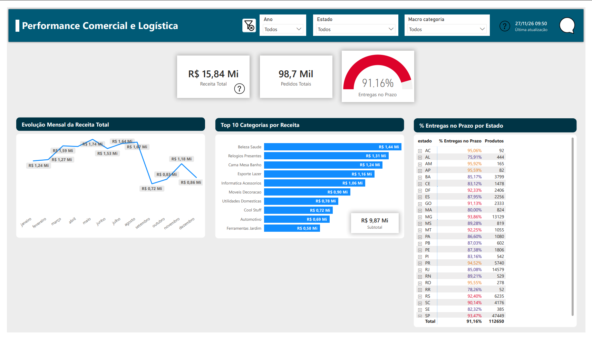
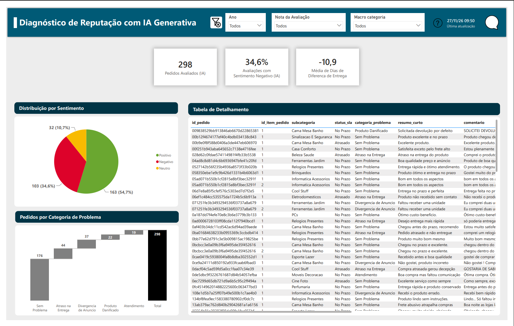

# Proj_Git_Databricks_PBI
# Diagnóstico de Reputação e Gargalos Logísticos — Lakehouse & IA Generativa

Pipeline de dados ponta a ponta construído para cruzar indicadores quantitativos de vendas e prazos de entrega (dataset público da Olist) com análise qualitativa automatizada de avaliações de clientes via Inteligência Artificial Generativa.

---

## Problema de Negócio

Em operações de e-commerce, métricas tradicionais de SLA (prazo estimado vs. entrega real) apontam *onde* há atraso, mas não revelam a percepção real do cliente nem diferenciam falhas logísticas de problemas de produto ou anúncio. Este projeto responde a duas perguntas centrais:
1. **Qual o desempenho comercial e de pontualidade logística por macrocategoria e estado?**
2. **Quais são os principais motivos de insatisfação relatados nos comentários dos clientes e como eles se relacionam com o atraso na entrega?**

---

## Arquitetura e Stack Tecnológica

* **Versionamento:** Git e GitHub integrados diretamente ao workspace via **Databricks Git Folders**.
* **Engenharia de Dados (Databricks / Unity Catalog / Delta Lake):**
  * **Camada Bronze:** Ingestão dos 5 arquivos CSV brutos (`orders`, `order_items`, `order_reviews`, `products`, `customers`) em tabelas Delta.
  * **Camada Silver:** Tratamento de tipos, cálculo de diferença de dias e status de SLA (`No Prazo`, `Atrasado`, `Não Entregue`) em SQL, além de amostragem de 300 avaliações com texto.
  * **Enriquecimento com IA (Python + API Gemini):** Script Python estruturado em lotes (*batching* de 50 registros) consumindo o modelo **Gemini 3.5 Flash Lite** com saída forçada em JSON para classificar `sentimento`, `categoria_problema` e `resumo_curto`, respeitando limites de cota (RPM/TPM/RPD) e utilizando gravação incremental (*checkpoint* em Delta) para evitar desperdício de requisições.
  * **Camada Gold (Star Schema):** Modelagem dimensional (`fact_vendas`, `dim_clientes`, `dim_produtos`, `dim_avaliacoes_ia` e `dim_calendario`), incluindo deduplicação determinística de avaliações por pedido (`ROW_NUMBER`) e criação da hierarquia `macro_categoria` / `subcategoria` via `CASE WHEN` em SQL.
* **Business Intelligence & Storytelling (Power BI):**
  * Conexão direta ao **SQL Warehouse** do Databricks (modo *Import*).
  * Tratamento auxiliar no **Power Query** (tabela *de-para* relacionando siglas de UF aos nomes completos dos estados) e criação de tabela de métricas (`DateTime.LocalNow()`) para rastreabilidade da última atualização.
  * Recursos de UX no relatório: **Indicadores (*Bookmarks*)** para exibição de premissas metodológicas e limpeza rápida de todos os filtros da página.

---

## Estrutura do Repositório

```text
Proj_Git_Databricks_PBI/
├── 01_ingestao_bronze          # Criação dos schemas Medalhão e auditoria de volumetria
├── 02_tratamento_silver        # Limpeza SQL, regras de SLA e seleção da amostra para IA
├── 03_enriquecimento_ia_silver # Pipeline Python com API Gemini (JSON estruturado e checkpoint)
├── 04_modelagem_gold           # Construção do Star Schema e hierarquia de categorias
└── README.md                   # Documentação do projeto
```

---

## Dashboard Executivo

### Página 1 — Performance Comercial e Logística
Visão geral de faturamento, volume de pedidos, `% Entregas no Prazo`, evolução temporal, ranking por `macro_categoria` (com *drill-down* para `subcategoria`) e matriz dinâmica de desempenho por estado com escala de calor.



### Página 2 — Diagnóstico de Reputação com IA Generativa
Análise da amostra enriquecida pelo Gemini, cruzando distribuição de sentimentos, classificação automática das causas de reclamação (`Atraso na Entrega`, `Produto Danificado`, `Divergência de Anúncio`, `Atendimento`) e tabela analítica detalhada com o resumo gerado pela IA lado a lado com o comentário original e o status real do SLA.



---

## Principais Aprendizados e Decisões Técnicas

* **Controle de Cotas e Resiliência em APIs de LLM:** Agrupar 300 registros em lotes de 50 reduziu o consumo para poucas requisições (~10 mil tokens totais), enquanto a persistência a cada lote em tabela Delta protegeu o progresso contra instabilidades temporárias (`HTTP 503`).
* **Granularidade no Star Schema:** Deduplicar as avaliações para manter 1 registro por `id_pedido` na `dim_avaliacoes_ia` garantiu relacionamentos `1:N` íntegros com a `fact_vendas`, evitando duplicação de receita nas medidas DAX.
* **Visualização Geográfica:** A substituição de mapas tradicionais por uma matriz dinâmica com formatação condicional por escala de calor entregou leitura comparativa imediata entre os 27 estados brasileiros sem ambiguidades de geocodificação.

---

## Como Reproduzir?

1. Clone este repositório no seu workspace do Databricks utilizando **Git Folders**.
2. Baixe o *Brazilian E-Commerce Public Dataset by Olist* (Kaggle) e carregue os 5 CSVs principais no schema `bronze`.
3. Execute os notebooks `01` a `04` em sequência (inserindo sua chave gratuita do Google AI Studio no *widget* do notebook `03`).
4. Conecte o Power BI Desktop ao endpoint do seu **SQL Warehouse** apontando para o schema `gold`.

---

## Plataformas, Softwares e Contas Utilizadas:
- Databricks Free Edition
- Google AI Studio Free
- Gemini Plus (modelos Gemini 4 Hydrogen "Médio" e "Alto", para a concepção da estrutura do estudo, geração desse arquivo .markdown e gerações pontuais)
- Power BI Desktop v2.1601151.0
- Excel 2026 v2611
